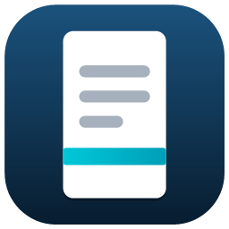
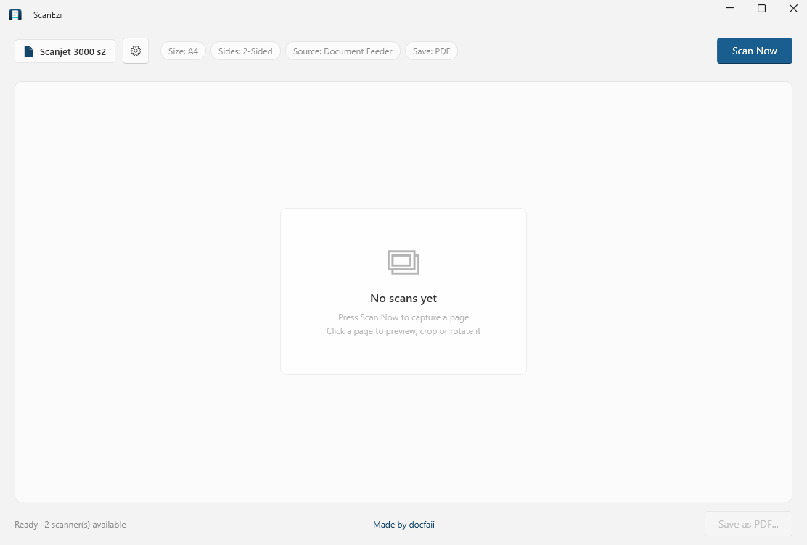
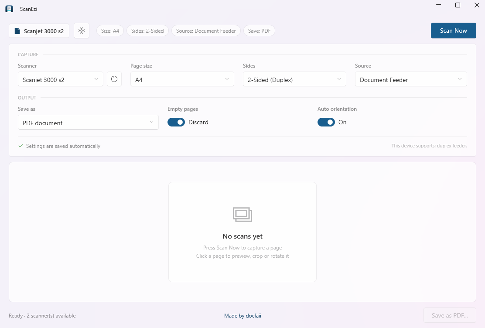

<p align="center">
  
</p>

<h1 align="center">ScanEzi</h1>

<p align="center">
  <em>A small, fast Windows scanner app — a modern replacement for HP Easy Scan.</em>
</p>

<p align="center">
  
  
  
  
  <a href="https://github.com/docfaii/ScanEzi/releases/latest"></a>
</p>

---

ScanEzi scans documents from any scanner Windows knows about, shows the pages as a thumbnail
gallery, and saves them as a multi-page PDF or as individual JPGs. It handles duplex sheets,
detects and skips empty pages, and lets you crop and rotate each page in a full-size preview.

It is a single small window with no account, no telemetry, and no services — it talks directly to the
WIA scanner stack through `Windows.Devices.Scanners`. When you close the window it waits quietly in
the notification area, so pressing the Scan button on the scanner still starts a scan.

<p align="center">
  
</p>

## Features

- **Works with any WIA scanner** — flatbed, document feeder, or both. Devices are discovered
  automatically and can be re-enumerated from the settings panel.
- **Duplex scanning** — 1-sided or 2-sided on devices with a duplexing feeder. The choice is
  remembered **per device**, so a simplex scanner never inherits it.
- **A4 by default** — plus Letter and Legal, switchable per scan.
- **PDF or JPG output** — PDF is the default; JPG is one click away. The active format is shown in
  the header and on the save button.
- **Empty page detection** — a duplex pass over a single-sided sheet produces an all-black frame from
  the sensor that saw nothing. ScanEzi recognises those, and fully blank white sheets, and leaves them
  unticked when saving — while still showing them in the gallery with a red cross so you can see
  exactly what the scanner returned.
- **Tick what you save** — every page in the gallery has a checkbox. Untick anything you don't want
  in the output; the save button and status line count what will be written.
- **New Scan** — clears the gallery and its temporary files and puts the app back at ready-to-scan
  without a restart.
- **The scanner's Scan button works** — pressing the physical Scan button on the device starts a scan,
  even when the ScanEzi window is closed. The app stays in the notification area for exactly this
  reason; the tray menu offers **Open ScanEzi**, **Scan now** and **Quit ScanEzi**.
- **One copy at a time** — launching ScanEzi while it is already in the tray brings the existing window
  forward instead of starting a second copy and registering the scan button twice.
- **Auto orientation** — pages fed upside down or sideways are turned upright using the Windows OCR
  engine. It only turns a page when it is confident, so nothing is rotated by guesswork.
- **Full-size preview** — click any thumbnail to open the page at full size and rotate it, drag a crop
  selection, or both, before applying the edit back to the gallery.
- **Fluent, native look** — Mica backdrop, rounded corners, and Fluent controls via
  [WPF-UI](https://github.com/lepoco/wpfui), so it sits naturally next to Windows 11 apps.
- **Nothing to configure twice** — every setting is saved the moment you change it, and restored on
  the next launch. No OK / Apply buttons.

## Requirements

| | |
|---|---|
| OS | Windows 10 version 1809 (build 17763) or newer — Windows 11 recommended for the Mica backdrop |
| Runtime | None — the installer and self-contained build bundle everything. The framework-dependent zip needs the .NET 8 Desktop Runtime |
| Hardware | A connected scanner exposed through WIA |

Auto orientation additionally needs a Windows OCR language pack. Every standard Windows install has
one; if none is present the feature quietly does nothing and pages are left as scanned.

## Install

Download `ScanEzi-<version>-setup.exe` from the latest release and run it. The installer is per-user,
needs no administrator rights and bundles everything it requires, so there is no .NET prerequisite.

Prefer a portable copy? The release also carries two zips:

- **Self-contained build** — nothing else to install; unzip and run `ScanEzi.exe`.
- **Framework-dependent build** — smaller, requires the
  [.NET 8 Desktop Runtime](https://dotnet.microsoft.com/download/dotnet/8.0).

ScanEzi writes only to your user profile. The installer registers an uninstaller in Windows settings.

### Updates

ScanEzi 2.0 and later check GitHub Releases on launch. When a newer release is available, the
package that matches your copy is downloaded in the background and installed the next time you
restart — installed copies run the new installer silently, portable copies are replaced in place.
The **UPDATES** section in Settings shows the installed version, lets you turn automatic checks on
or off, and provides a **Check for updates** button for manual checks.

## Build from source

```powershell
git clone https://github.com/docfaii/ScanEzi.git
cd ScanEzi
dotnet build -c Release
dotnet run -c Release
```

Or use the helper script, which builds and launches in one step:

```powershell
.\BuildAndRun.ps1
```

### Publish a single-file executable

```powershell
dotnet publish -c Release -r win-x64 --self-contained true /p:PublishSingleFile=true
```

The result lands in `bin\Release\net8.0-windows10.0.22621.0\win-x64\publish\ScanEzi.exe` and runs on a
machine with no .NET runtime installed.

### Releasing

Pushing a tag such as `v2.0.0` runs the `Release` workflow, which builds the installer and both
Windows x64 packages and publishes them to GitHub Releases. The workflow uses
`docs/release-notes/<tag>.md` when that file exists; otherwise it lets GitHub generate the notes. To
re-run a release from the Actions tab, use the **Release** workflow's manual dispatch and supply the
version.

The installer comes from `installer\ScanEzi.iss` (Inno Setup) and is compiled from the self-contained
publish so it has no runtime prerequisite. To build it locally:

```powershell
dotnet publish ScanEzi.csproj -c Release -r win-x64 --self-contained true -o publish/self-contained
iscc installer\ScanEzi.iss /DMyAppVersion=2.0.0 /DSourceDir=..\publish\self-contained
```

The result lands in `installer\output\ScanEzi-<version>-setup.exe`. It installs to
`%LOCALAPPDATA%\Programs\ScanEzi`.

## Usage

1. Launch `ScanEzi`. The connected scanner is picked up automatically.
2. Click the **gear** icon to choose the scanner, page size, sides, source, save format, empty-page
   handling, and auto orientation. Settings persist as you change them.
3. Click **Scan Now**. Each page appears in the gallery, numbered, with empty pages marked by a red
   cross. Every page has a checkbox — empty pages arrive unticked.
4. Click a thumbnail to open the **preview** — rotate it, or press **Crop** and drag out the area to
   keep. **Apply** writes the edit back to the gallery; **Cancel** discards it.
5. Click **Save as PDF…** (or **Save Images…**) to export the ticked pages.
6. Click **New Scan** to clear the gallery and start again. The pages you discard are deleted from the
   temporary folder.

Closing the window leaves ScanEzi in the notification area so the scanner's Scan button keeps working.
Left-click the tray icon — or launch ScanEzi again — to bring the window back, and use **Quit ScanEzi**
in its right-click menu to exit for real. The **SCAN BUTTON** section in Settings turns this off with
**Keep running in the tray**, shows whether the listener is registered, and the tray tooltip reports the
version, the listener state and the number of pages waiting.

Pages marked with a red cross are empty. They stay in the gallery so you can see what the scanner
returned, but they are unticked, so they are left out of the save. Tick one to include it, or set
**Empty pages → Keep** to have them arrive ticked.

The settings panel holds everything that is not needed during a scan, including the refresh button
for the scanner list:

<p align="center">
  
</p>

## How empty pages are detected

A duplex scan of a single-sided sheet gives one good frame and one frame the sensor never exposed.
The second is essentially pure black. A sheet that was never written on comes back as pure paper.

ScanEzi classifies each page as *content*, *black*, or *white* by measuring ink relative to the page's
own paper white level, after trimming the outer 6% of the sheet (sheet edge and scan-bed background
are not content). On real scans a printed A4 page carries about **4.9% ink** against **0.025%** for a
genuinely blank one — roughly a 200× margin, so faint content is always kept and the thresholds sit
far from either population.

The sample is taken at 450 px rather than a coarser size on purpose: at 160 px the interpolation
averages thin text into the paper and a printed page reads as blank.

## How orientation is detected

The Windows OCR engine reads text far more reliably the right way up, so each page is recognised in
all four rotations and the orientation that yields the most text wins. If the upright reading is
already close to the best score, the page is left alone; if nothing legible is found at all, it is
also left alone. Guessing is never preferred over doing nothing.

The whole pass runs on a background thread after the scan, and can be switched off under
**Auto orientation** in the settings panel.

## Project structure

| File | Purpose |
|------|---------|
| `App.xaml` / `App.xaml.cs` | Application entry point and WPF-UI theme dictionaries |
| `MainWindow.xaml` | Fluent layout — device card, header badges, settings panel, gallery, footer |
| `MainWindow.xaml.cs` | UI controller: discovery, settings, capabilities, scanning, gallery, save |
| `PagePreviewWindow.xaml` / `.cs` | Full-size page preview with crop and rotate |
| `ScannerService.cs` | Scanner enumeration, capability probing, and scan execution |
| `ImageProcessor.cs` | Rotate, crop, and save-as-JPG |
| `AutoOrientation.cs` | OCR-based orientation detection |
| `PageContentAnalyzer.cs` | Black/white empty-page classification |
| `PdfExportService.cs` | Dependency-free multi-page PDF writer (embeds each page as JPEG) |
| `AppSettings.cs` | Persisted settings model |
| `ScanLog.cs` | Diagnostic log writer |
| `HpEasyScanDialogGuard.cs` | Closes the HP Easy Scan error dialog raised by the scanner's STI button handler |
| `ScannerButtonService.cs` | Listens for the scanner's hardware Scan button through the WIA device-manager callback |
| `TrayIcon.cs` | Notification-area icon, tooltip, balloon and right-click menu via `Shell_NotifyIcon` |
| `UpdateService.cs` | GitHub release checks, verified downloads, installer/portable update apply |
| `installer\ScanEzi.iss` | Inno Setup script used by the release workflow |

## Files and diagnostics

| Path | Contents |
|------|----------|
| `%APPDATA%\ScanEzi\settings.json` | Saved settings — delete it to reset the app |
| `%TEMP%\ScanEzi` | Pages captured during the session |
| `%LOCALAPPDATA%\ScanEzi\scan.log` | Per-scan diagnostics: device, source, duplex read-back, page count |
| `%LOCALAPPDATA%\ScanEzi\button-service.log` | Scan-button listener diagnostics: registered events and callback errors |
| `%LOCALAPPDATA%\ScanEzi\crash.log` | Unhandled exception details |
| `%LOCALAPPDATA%\ScanEzi\update.log` | Update helper log — written after the app restarts into a new version |
| `%LOCALAPPDATA%\Programs\ScanEzi` | Default install folder when installed with the setup program |

## Notes and known behaviour

- `ImageScannerScanSource.Default` is unreliable across drivers, so the source is always resolved
  explicitly. **Auto Detect** falls back to whatever the device actually supports.
- 2-sided scanning is verified rather than assumed: the duplex flag is written, read back, and
  re-asserted after the page size is applied, because some drivers silently reset it. If the device
  rejects the request, or accepts it but returns a single page, the app says so in the status banner.
- Several WIA drivers report `MaxNumberOfPages` as 1 and then honour it, truncating a feeder run to
  the first page. The app raises that limit before every scan.
- Some drivers answer a 2-sided request with one multi-page file rather than one file per side. Those
  files are split so each side becomes its own page.
- Some drivers return tiny placeholder files (tens of bytes) when a feeder is empty. Those are
  discarded and an actionable message is shown instead of a broken thumbnail.
- If HP's Still Image registration is present (printers and all-in-ones), Windows launches
  `SDSSLchr.exe` when the hardware Scan button is pressed. When the *HP Easy Scan* application is not
  installed that raises an error dialog; ScanEzi closes it automatically. The registration itself is
  machine-wide (`HKLM`), so a per-user app cannot remove it.
- Edits are written next to the source file in `%TEMP%\ScanEzi` as new JPEGs; the gallery points at
  the newest one.
- Closing the window hides ScanEzi to the notification area instead of exiting, because the hardware
  Scan button listener only exists while the process is running. **Quit ScanEzi** in the tray menu, or
  turning off **Keep running in the tray**, exits properly. Updates bypass this: the app exits fully
  before the installer restarts it.
- ScanEzi is single-instance per user session. A second launch hands its request to the running copy
  and exits, which also stops the scan button from being registered twice.
- Balloon notifications are shown through the shell, so they are subject to Windows notification
  settings. Portable copies have no Start-menu entry, so Windows may file them under a generic name.

## Contributing

Issues and pull requests are welcome.

1. Fork and create a topic branch.
2. Keep changes focused, and match the existing Fluent styling and code style.
3. Describe the scanner model you tested against in the pull request — driver behaviour varies
   widely, and a change that is right for one device is often wrong for another.

Please report scanner-specific problems with the relevant `scan.log` excerpt attached.

## Licence

Released under the [MIT Licence](LICENSE).

The app icon and screenshots in `docs/` are part of this project and covered by the same licence.
